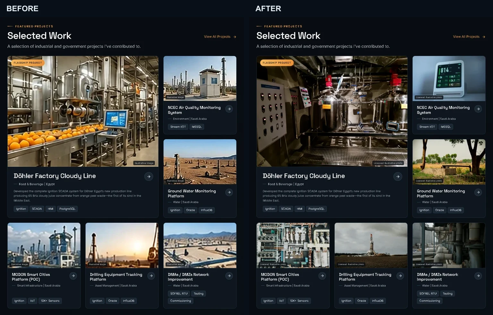
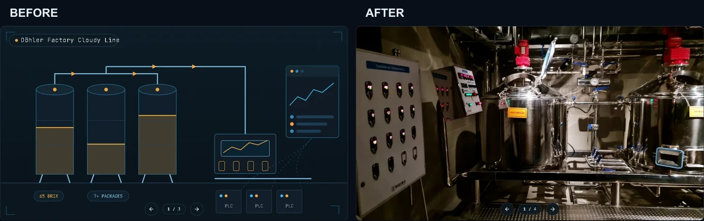

# Project image consistency — QA report

Branch: `feature/project-media-consistency`

Scope: project-cover quality/consistency and About signature quality only. The
approved homepage and case-study layouts were retained. No deployment was
performed.

## Shared-cover mapping

The cover path in this table is the single source used by the homepage card,
case-study primary hero and first gallery thumbnail.

| Project | Homepage / detail / thumbnail cover |
| --- | --- |
| Döhler Factory Cloudy Line | `/assets/projects/dohler-cloudy-line/cover.webp` |
| NCEC Air Quality Monitoring | `/assets/projects/ncec-air-quality/cover.webp` |
| Ground Water Monitoring | `/assets/projects/ground-water/cover.webp` |
| MODON Smart Cities Platform (POC) | `/assets/projects/modon-poc/cover.webp` |
| Drilling Equipment Tracking | `/assets/projects/drilling-equipment/cover.webp` |
| DMAs / DMZs Network Improvement | `/assets/projects/water-network/cover.webp` |
| MODON Web & Mobile App Testing | `/assets/projects/modon-testing/cover.webp` |

The three pre-existing technical views (`scene`, `flow`, `ops`) remain after
the shared cover, so each case-study gallery now contains four items.

## Asset-quality audit

The legacy card derivatives were larger files created from tiny reference
crops, so their dimensions did not represent genuine source detail. They were
removed from runtime use rather than upscaled again.

| Project | Legacy source pixels | New primary cover pixels |
| --- | ---: | ---: |
| Döhler | 159×76 | 2000×1500 |
| NCEC | 160×77 | 2000×1334 |
| Ground Water | 156×76 | 2000×1333 |
| MODON Smart Cities | 160×54 | 2000×1333 |
| Drilling Equipment | 158×54 | 2000×1333 |
| NWC DMAs / DMZs | 156×54 | 2000×1333 |
| MODON Testing | 160×54 shared crop | 2000×1333 unique cover |

All new photographs retain their source aspect ratios. They are encoded as
WebP and rendered through Next.js `Image` with responsive `sizes`; no AI
upscaling, fabricated detail or sharpening pass was used.

Full creator/source/license provenance is in
[`PROJECT-ASSET-SOURCES.md`](./PROJECT-ASSET-SOURCES.md).

## Signature

The 138×33 `public/assets/signature.webp` is retained as the authenticity
reference. The live About section now uses `public/assets/signature.svg`, a
path trace of those same visible strokes with the dark board background
removed. No cursive font or substitute handwriting was introduced. The SVG
uses a 1104×264 view box and stays sharp at desktop, mobile and retina sizes.

## Visual comparisons

### Homepage project covers

### Case-study primary visual

### About signature

The complete local screenshot sets are generated by
`scripts/capture-project-media.cjs` into:

- `screenshots/project-media-before/`
- `screenshots/project-media-after/`
- `screenshots/case-studies-media/`

They cover English and Arabic at 1440×900 and 390×844, all seven case-study
primary visuals, the homepage project area, the About signature and an English
desktop full-page reference.

## Technical QA

Completed locally:

- `npm run typecheck` — pass.
- `node scripts/verify-project-media.cjs http://127.0.0.1:4321` — pass for
  seven shared-cover mappings, first-thumbnail equality, four-item galleries,
  keyboard navigation, EN/AR, 1440×900 / 390×844, signature intrinsic size,
  direct WebP/SVG asset HTTP responses and MIME types, console/page errors,
  failed requests and horizontal overflow.
- `node scripts/route-regression.cjs http://127.0.0.1:4321` — all seven
  project routes in EN/AR returned successfully with no browser errors; home
  and CV checks also passed.
- `node scripts/capture-case-studies.cjs screenshots/case-studies-media
  http://127.0.0.1:4321` — pass, including thumbnail/button/keyboard gallery
  interactions and mobile overflow checks.
- `npm run build` — OpenNext Cloudflare production build completed
  successfully.

During QA, the existing NCEC vector scene exposed a React hydration warning
because a mutable deterministic random generator was being passed into a child
component. `ProjectArt.tsx` now creates that seeded generator inside each scene
render, preserving the same artwork while making SSR and hydration stable.

## OpenNext / Cloudflare asset check

After the production build, `.open-next/assets/assets/projects/` contains all
seven new cover WebPs at the dimensions above, and
`.open-next/assets/assets/signature.svg` contains the traced signature.

This verifies the local OpenNext bundle only. The Cloudflare Worker was **not
deployed**, so no claim is made that production currently serves these new
files. Production HTTP/cache/commit correspondence must be checked only after
deployment is separately authorized.

## Remaining asset limitation

No authentic high-resolution client/project photographs were supplied in the
repository for these seven projects. The replacements are therefore clearly
labeled, licensed illustrative photographs rather than claimed project
photography. If genuine approved project photos are supplied later, each can
replace the corresponding manifest cover without changing homepage or gallery
logic.
